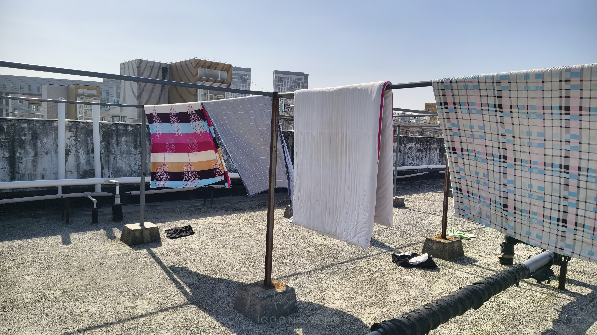
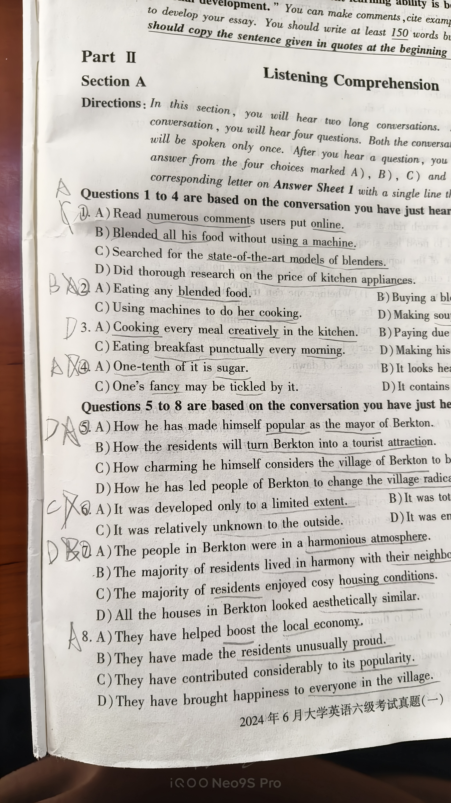
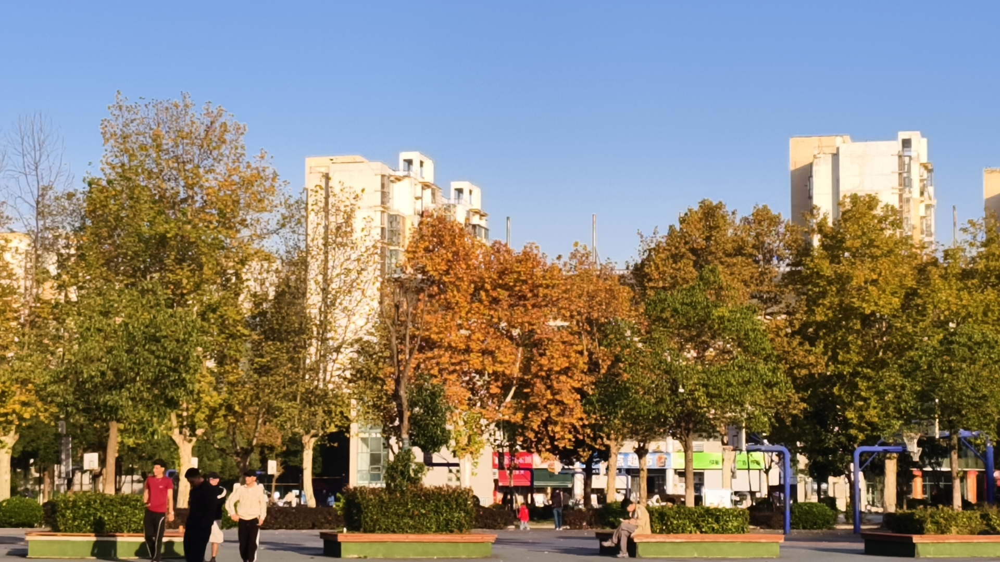
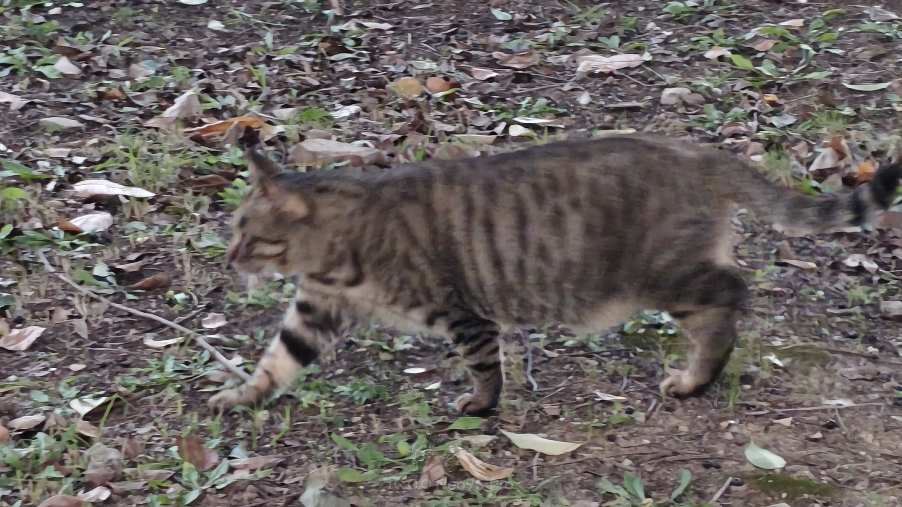
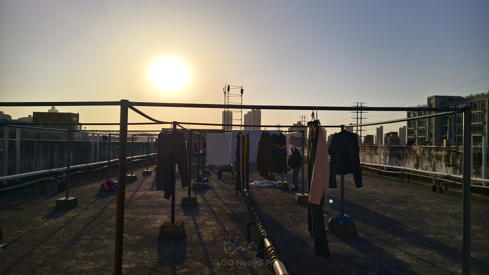

　　今天天气很好，一睁眼，寝室里就是一片晴朗的样子，忍不住面向窗外的阳光伸了个懒腰

  不得不说今天真的很适合晒被褥
  
  螨虫都去死吧ƪ(˘⌣˘)ʃ

  　　中午吃完饭后去了图书馆，十二月十二号就要考四级了，不学一下还是有点慌的
    
现在退钱还来得及吗(┬┬﹏┬┬)

学不下去，回去的时候看到的学校，美好的午后，一切好像都黄澄澄的，看得我心里暖洋洋

乐跑的时候碰到的小猫，还挺帅的

收被褥了，之前忘了收，晚上再去都有点湿了，白晒的

今天很幸福，晚安世界(❁´◡`❁)
